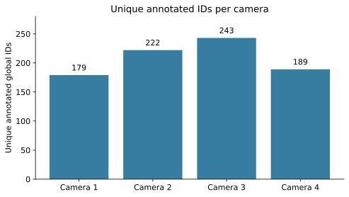

# RoundaboutHD: exploring vehicle annotations

I used this project to explore how vehicles are recorded by four cameras at different roundabouts. I wanted to understand what the data contains, compare the cameras, and check whether the annotations are suitable for further analysis.

The project uses the existing RoundaboutHD annotations. I did not train a new machine-learning model.

## My questions

- How many annotated vehicles appear in each camera, and how does the number change over time?
- Are there missing observations or conflicting records?
- For vehicles seen by all four cameras, does annotated observation time differ between cameras?

## What I did

I used Python, pandas, NumPy, Matplotlib, and SciPy to inspect the files, check repeated records, summarize observations, and create three charts. I also compared the single-camera and multi-camera annotations for selected vehicles that appeared without boxes in the contact sheets.

I added a separate preparation and cleaning step: I checked the format, marked missing world coordinates, flagged conflicting boxes, and created a table that counts each observation once. I kept the source files and observation gaps unchanged.

For the statistical comparison, I selected the same 74 vehicle IDs in all four cameras and applied a Friedman test. I measured annotated frame time by dividing the number of distinct annotated frames by 15 frames per second.

## What I found

The multi-camera file contains **311 unique vehicle IDs** and **177,782 rows**. These are the IDs included in this file, not a confirmed count of every vehicle passing through the area.

| Camera | Unique annotated IDs | Average annotated IDs per frame |
| --- | ---: | ---: |
| 1 | 179 | 3.98 |
| 2 | 222 | 5.54 |
| 3 | 243 | 5.85 |
| 4 | 189 | 4.38 |

Camera 3 has the highest annotated count. I could not establish whether this comes from traffic patterns, camera coverage, or which vehicles were included in the annotations.

I found **26 conflicting observation keys**: the same vehicle ID has different boxes in the same camera and frame. For time and count calculations, I counted each key once and kept the original records for inspection.

The Friedman test found differences between cameras (**p ≈ 0.000033**), with a relatively small effect size (**Kendall's W ≈ 0.106**). This is an exploratory result: the selected vehicles may not represent all traffic, and observations of different vehicles may be related.

## What the results do not tell me

Some visible vehicles have records in single-camera annotations but no matching boxes in the multi-camera file. This does not automatically mean the dataset is badly annotated. The sources include different records, and the reason for each exclusion is still unclear.

Annotated frame time is also different from travel time: a vehicle can disappear from the records and reappear later. I therefore did not use it to calculate vehicle speed. The difference between the 311 IDs in this file and the published overall count of 512 remains unresolved.

## Files to open

- [Final analysis notebook](final_analysis.ipynb) — the complete analysis with saved outputs.
- [Short report](reports/final_report.md) — the findings and limitations.
- [What I did](reports/what_i_did.md) — the questions, methods, and findings.
- [Data preparation and cleaning](reports/data_preparation_and_cleaning.md) — what I changed and what I kept for review.
- [Checks and corrections](reports/verification.md) — details behind the data-quality findings.
- [Results](results/) and [figures](figures/) — the exported tables and charts.

`analysis.ipynb` is my earlier working notebook. Use `final_analysis.ipynb` for the final results.

## Sources

- [RoundaboutHD dataset — University of Bath](https://researchdata.bath.ac.uk/1574/)
- [Authors' GitHub repository](https://github.com/siri-rouser/RoundaboutHD)
- [RoundaboutHD paper](https://arxiv.org/html/2507.08729v2)
- [Authors' multi-camera annotation script](https://github.com/siri-rouser/multi_camera_tracking_labelling_tool/blob/main/MCVT_data_creation.py)

